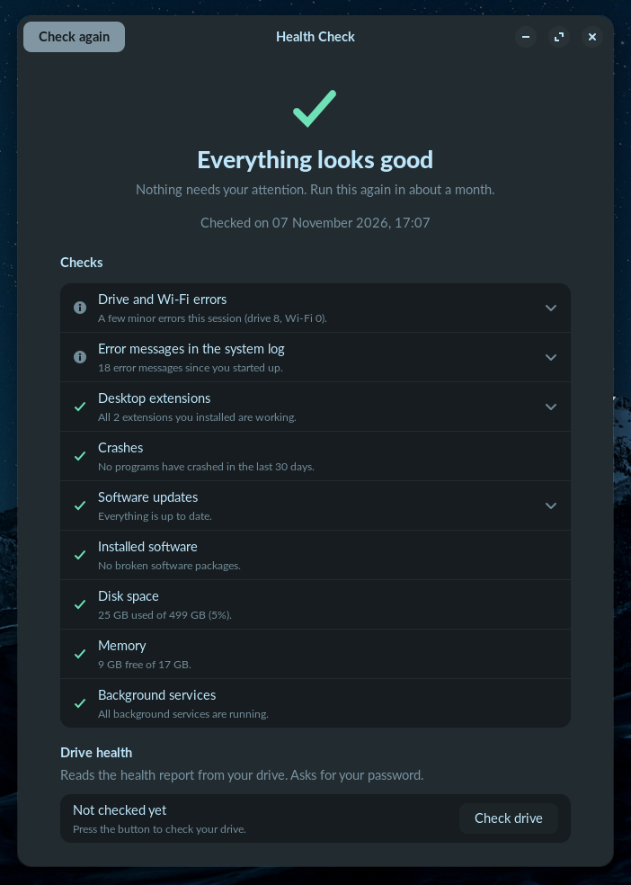

# Desktop Checkup

**GitHub repository:** `dariocostanzo/desktop-checkup`  
**Short description:** Privacy-first local health checks for GNOME on Ubuntu and Zorin OS.  
**Application ID:** `io.github.dariocostanzo.DesktopCheckup`  
**License:** GPL-3.0-or-later

Desktop Checkup is a small GNOME desktop app for Ubuntu and Zorin OS that checks common software, hardware, storage, memory, service, and system-log signals, then explains what they may mean in plain language. It is designed to be useful without sending information anywhere; drive health is checked only when you choose it, and system-changing fixes always show a confirmation first.

## Screenshot



## Install

### Install the Ubuntu 24.04 / Zorin OS 18 package

1. Open the project's GitHub page and select **Releases**. Open the latest release and download `health-check-desktop_0.1.0-1_all.deb` from its **Assets** list. Save it in your **Downloads** folder.
2. Open **Files**, go to **Downloads**, double-click the `.deb` file, and choose **Install** in Software Install.

You can also install it from a terminal. Run this from the folder where you downloaded the file (for example, `~/Downloads`):

```sh
cd ~/Downloads
sudo apt install ./health-check-desktop_0.1.0-1_all.deb
```

Find **Desktop Checkup** in the applications menu. The package installs GTK 4, libadwaita, Python bindings, and `smartmontools` as system package dependencies.

The application ID is `io.github.dariocostanzo.DesktopCheckup`. The AppStream developer ID and homepage URL identify the GitHub account and repository.

### Run from source

Install the system libraries and command-line tools first:

```sh
sudo apt install python3 python3-gi gir1.2-gtk-4.0 gir1.2-adw-1 smartmontools
```

Then run the single-file launcher from the project folder:

```sh
python3 health_check.py
```

To print the results in a terminal instead:

```sh
python3 health_check.py --cli
```

The app has no third-party Python runtime dependencies. GTK and the system tools are supplied by Ubuntu or Zorin OS.

## What it checks

- **Desktop add-ons:** looks for GNOME Shell extensions that are in an error or out-of-date state.
- **App crashes:** checks the local system crash record for the last 30 days.
- **Hardware messages:** counts kernel AER messages and groups them by the device name in each log line. It does not assume that a computer has Wi-Fi or a particular drive model.
- **Updates:** reads the update list already stored on the computer. It does not download an update list or install updates.
- **Installed software:** checks for unfinished or broken Debian packages.
- **Storage space:** checks free space on the root filesystem.
- **Memory:** reports total and currently available memory.
- **Background tasks:** checks failed system and user services.
- **System log:** looks at error-level messages from the current boot and hides a small set of known, commonly harmless messages.
- **Drive health (manual):** when you press **Check drive**, lists internal disks with `lsblk` and checks each eligible disk with `smartctl`. NVMe and SATA drives are supported; removable USB drives are excluded. Drives that do not support SMART, or whose report cannot be read, are reported as not checkable rather than healthy.

Some checks may say they could not run when a system tool is missing, a log is unavailable, or a device does not support the requested information. An **OK** result is a simple signal, not a guarantee that hardware or software has no problem.

## Privacy

**Guarantee: Desktop Checkup never sends data over the network and never contacts a server.** It has no network client imports or network features. Checks use local system tools and local logs; the update check reads the existing local package list only. The app does not fetch updates or automatically install packages.

The network-import restriction is covered by an automated test. The app does not include a Flatpak build: Flatpak's sandbox would block the system and device access needed for these checks.

## Fixes that need administrator access

Fixes change your system. Read every confirmation dialog, including the command it shows, before you continue; choose **Cancel** if you are unsure. Administrator access is requested only for the actions below.

| Fix | Exact command shown | Why this is limited and safe |
|---|---|---|
| Finish configuring packages | `pkexec dpkg --configure -a` | Asks dpkg to finish configuration that is already pending; it does not fetch packages. |
| Clean unused package files | `pkexec env DEBIAN_FRONTEND=noninteractive apt-get -y -o DPkg::Lock::Timeout=0 autoremove` then `pkexec env DEBIAN_FRONTEND=noninteractive apt-get -y -o DPkg::Lock::Timeout=0 clean` | Removes packages apt marks as no longer needed and clears cached package archives. It does not remove personal documents. Review the confirmation before running it. |
| Restart one failed system service | `pkexec systemctl restart <validated-service.service>` | Only offers the first service reported failed, and its name must match a strict service-name pattern. Restarting a service can briefly interrupt the feature that uses it. |

Restarting a user service and switching off a GNOME extension do not use administrator access, but they still change settings and are also shown for confirmation.

## Supported systems

- Ubuntu 24.04 with GNOME 46 or later.
- Zorin OS 18 with GNOME 46 or later.
- A systemd-based desktop with `apt`, `dpkg`, `lsblk`, and `smartmontools`.

The `.deb` build is intended for Ubuntu 24.04 and Zorin OS 18. Other systems may work but are not supported or tested here.

## Tested on

Written with AI assistance. Testing to date is limited to the author's computer and the systems recorded in this table; no claim is made about other hardware. Automated tests do not replace manual testing on a real desktop.

| Machine | Operating system | Hardware notes | Result |
|---|---|---|---|
| Author's computer (details intentionally omitted) | Linux; exact distribution/version not recorded | Details intentionally omitted | Automated tests run; no manual hardware result recorded |
| Add another test machine |  |  |  |

## Name note

An [Ubuntu package named `health-check`](https://packages.ubuntu.com/noble/health-check) already exists for process monitoring, although it is not a well-known GNOME desktop app. Its package and `/usr/bin/health-check` command are already in use, so this project uses the distinct package and command names `health-check-desktop` and `health-check-desktop`. The chosen app display name is **Desktop Checkup**; **System Health Snapshot** is another possible name.

## Build a `.deb`

From the project directory, run:

```sh
./packaging/build-deb.sh
```

The package is written to `dist/`. The build script uses `dpkg-deb`; it does not make a Flatpak.

## Uninstall

Remove the package from Software or run:

```sh
sudo apt remove health-check-desktop
```

To remove its saved local check status as well:

```sh
rm -rf ~/.local/share/desktop-checkup
```

The second command removes only Desktop Checkup's saved status folder. The source launcher also has `--install` and `--uninstall` options for creating or removing a per-user menu entry and sign-in reminder.

## License

GPL-3.0-or-later. See [LICENSE](LICENSE).
